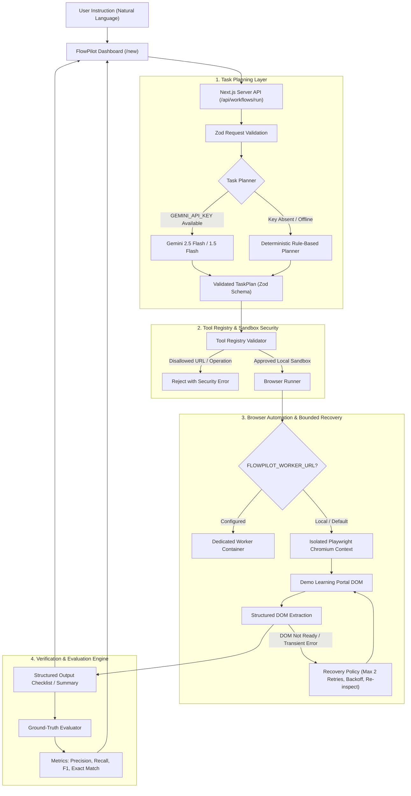

# FlowPilot — Agentic Browser Workflow Automation Platform

> **Software Engineering Placement Portfolio Project**  
> *Production-Ready Agentic Browser Automation with Model-Backed Task Planning, Deterministic Recovery & Rigorous Ground-Truth Evaluation*

[](https://nextjs.org/)
[](https://www.typescriptlang.org/)
[](https://playwright.dev/)
[](https://tailwindcss.com/)
[](https://zod.dev/)

---

## 🎯 Problem Statement & Motivation

Modern web automation frequently fails when deployed in production because traditional scripts rely on brittle CSS selectors and rigid, synchronous execution chains. Conversely, unconstrained LLM "web agents" that generate arbitrary browser JavaScript present severe security risks, non-deterministic hallucinations, and catastrophic latency.

**FlowPilot** solves this dilemma by pairing **AI-driven intent interpretation** with a **strictly typed, closed browser tool registry** and a **deterministic bounded recovery policy**.

- **Safe Planning**: Uses Gemini (with deterministic rule-based fallback) to classify user goals into structured schemas (`TaskPlan`).
- **Constrained Execution**: The agent cannot execute arbitrary code; it can only invoke registered, safety-guarded browser primitives against approved sandbox domains.
- **Self-Healing Recovery**: Automatically detects transient DOM delays or missing elements, backs off, re-inspects DOM state, and retries—boosting benchmark scenario pass rates from 40% (2/5) to 80% (4/5) overall, and achieving 100% (2/2) recovery on recoverable failures.
- **Evaluation Integrity**: Benchmarked against deterministic ground truth reporting Information Retrieval metrics (Precision, Recall, F1) and exact-match accuracy, with temporal anchor injection and zero hardcoded dates.

---

## 🏗️ Architecture & Execution Flow

The following diagram illustrates how user intent flows from the frontend down to the headless browser and back to the verification layer:



---

## ⚡ Supported Workflows

FlowPilot ships with end-to-end support for three real-world student portal automation tasks operating over dynamic DOM elements:

| Workflow | Intent & Goal | Target DOM Extraction | Ground-Truth Invariants |
| :--- | :--- | :--- | :--- |
| **Workflow A: 7-Day Checklist** | "Find all incomplete assignments due in the next 7 days and prepare a prioritized checklist." | Queries `[data-testid="assignment-card"]`, reads dates, weights, and status badges. | Filters out completed (`CS410-PS3`, `HUM102-E2`) and overdue (`CS301-A1`, `SE250-D1`). Returns 4 items prioritized by deadline proximity and weight. |
| **Workflow B: Course Summary** | "Summarize all enrolled courses, including total assignments and completion status." | Scans all unique course codes, aggregates total, completed, in-progress, and not-started counts. | 100% exact match across all 5 courses (`CS 301`, `CS 410`, `SE 250`, `MATH 220`, `HUM 102`). |
| **Workflow C: Overdue Audit** | "Find all overdue assignments that have not been completed and list them by priority." | Isolates items with `dueDate < referenceDate` and `status !== 'completed'`. | Identifies overdue items (`CS301-A1`, `SE250-D1`) with zero false positives from upcoming deadlines. |

### Strict Security Boundaries
- **Domain Sandbox Whitelist**: Browser automation is strictly constrained to the local demo learning portal (`/demo/learning-portal`) and localhost. Arbitrary external URL navigation requests (`https://google.com`, `https://attacker.com`) are rejected before the browser spawns.
- **Typed Tool Registry**: Only 4 typed operations are allowed: `navigate_to_portal`, `wait_for_selector`, `extract_dom_elements`, and `filter_and_aggregate`. Arbitrary client-directed code execution is prohibited.
- **Resource Limits**: Every run enforces an action budget (max 15 actions) and an execution deadline (max 30 seconds). All Playwright browser contexts are closed inside `finally` blocks to prevent zombie processes.

---

## 🛡️ Measurable Recovery & Failure Injection

FlowPilot features an explicit **Bounded Recovery Policy** that separates transient infrastructure hiccups from permanent semantic failures.

### Controlled Failure Scenarios
The demo learning portal includes a deterministic failure injection layer enabled via `X-FlowPilot-Failure-Mode` headers:

1. `none`: Standard execution without synthetic faults.
2. `delayed_element`: Target DOM container renders after a controlled 1,200ms delay.
3. `transient_failure`: First DOM query throws an artificial detachment exception; subsequent queries succeed.
4. `missing_element`: Target selector is permanently absent (unrecoverable).
5. `malformed_data`: Assignment card missing required due date attributes (schema anomaly).

### Recovery Policy Rules
- **Classification**: Detects transient DOM attachment issues versus terminal missing elements.
- **Max Retries**: Exactly 2 retries per recoverable operation with exponential backoff (250ms, 500ms).
- **DOM Re-Inspection**: Re-checks selector presence before retrying rather than blindly firing operations.
- **Non-Destructive Guarantee**: Recovery never auto-retries destructive actions.
- **Audit Trace**: Every failure, backoff delay, and recovery attempt is logged into the execution trace.

### Benchmark Results (Controlled Synthetic Test)

> *Note: These figures represent a controlled regression suite on synthetic faults, not a generalized claim of real-world internet reliability.*

| Execution Mode | Scenarios Passed | Success Rate | Recoverable Faults Cleared |
| :--- | :--- | :--- | :--- |
| **Baseline (No Recovery)** | 2 of 5 scenarios | 40.0% | 0 of 2 (0.0%) |
| **FlowPilot Bounded Recovery** | **4 of 5 scenarios** | **80.0%** | **2 of 2 (100.0%)** |

*Why 4/5?* FlowPilot deliberately fails scenario 4 (`missing_element`) with an explicit unrecoverable error rather than looping infinitely, honoring the hard action budget.

---

## 📊 Evaluation Methodology & Integrity

FlowPilot emphasizes **honest, transparent evaluation**:
- **Information Retrieval Metrics**: Computes Precision, Recall, and F1-Score for extracted item sets.
- **Separation of Concerns**: Distinguishes **Task Execution** (did the browser run to completion without crashing?) from **Output Correctness** (does the extracted data match the ground-truth set?).
- **Dynamic Temporal Anchoring**: Eliminates hardcoded dates. Both the runtime runner and the ground-truth evaluator accept an injected reference date (`FLOWPILOT_REFERENCE_DATE=2026-10-25`), ensuring boundary invariants (`due-today`, `window-end`, and `overdue`) are evaluated identically.
- **Comprehensive Edge Cases**: Automated test suites explicitly verify empty result windows, malformed schema anomalies, and unsupported task rejection.

---

## ⏱️ 2-Minute Demo Walkthrough

### Step 1: Open New Workflow
1. Navigate to **[http://localhost:3000/new](http://localhost:3000/new)**.
2. Under **Quick Workflow Templates**, click **"7-Day Checklist"** (or Course Summary / Overdue Audit).

### Step 2: Trigger Live Automation
3. Click the cyan **"Run Workflow"** button.
4. Observe the live execution progress in the right-hand panel:
   - **Step 1: Task Planning**: See intent parsed and model source displayed (`gemini_2.5_flash` or `deterministic_fallback`).
   - **Step 2: Browser Engine**: Headless Chromium spawns, navigates to the learning portal, queries DOM cards, and normalizes records.
   - **Step 3: Verification**: Ground truth validator calculates Precision, Recall, and F1-Score.

### Step 3: Inspect Verified Output & History
5. View the prioritized checklist cards with due dates, course codes, and urgency badges.
6. Click **"Run History"** in the sidebar to view recorded duration, action counts, and verification badges.
7. Click **"Evaluations"** to view real-time benchmark summaries and failure-mode recovery metrics.

---

## 💻 Local Setup & Developer Guide

### Prerequisites
- Node.js 18+ (tested on Node v20 and v22)
- npm or pnpm

### Installation

```bash
# Clone the repository
git clone https://github.com/your-username/flowpilot.git
cd flowpilot

# Install dependencies
npm install

# Install Playwright Chromium headless binary
npm run install:browsers
```

### Environment Configuration

Create a `.env.local` file from the provided example:

```bash
cp .env.example .env.local
```

Configurable options:
```env
# Base URL for internal navigation and API calls
FLOWPILOT_BASE_URL=http://localhost:3000

# Temporal reference date for workflow evaluation (default: 2026-10-25)
FLOWPILOT_REFERENCE_DATE=2026-10-25

# Optional: Google Gemini API Key for model-backed task planning
# If omitted, FlowPilot runs in deterministic fallback mode with 100% test parity
GEMINI_API_KEY=your_gemini_api_key_here

# Optional: Remote Browser Worker Endpoint (for serverless deployments)
FLOWPILOT_WORKER_URL=
```

### Running the Application

```bash
# Start Next.js development server
npm run dev
```
Open **[http://localhost:3000](http://localhost:3000)** in your browser.

---

## 🧪 Automated Verification & Benchmark Commands

FlowPilot includes three dedicated test suites runnable via `tsx`:

### 1. Multi-Workflow & Integrity Suite (8 Test Cases)
Tests all 3 workflows, temporal boundaries, empty results, malformed data, tool registry security, and unsupported prompt rejection:
```bash
npm run workflows
```
*(Alias: `npm run test:workflows`)*

### 2. Ground-Truth Workflow Evaluation
Tests Workflow A against the learning portal with Information Retrieval metrics:
```bash
npm run eval
```
*(Alias: `npm run test:eval`)*

### 3. Failure-Injection & Recovery Benchmark
Runs 10 executions across 5 controlled failure scenarios comparing baseline vs bounded recovery:
```bash
npm run benchmark
```
*(Alias: `npm run test:benchmark`)*

### 4. Production Build Verification
Ensures zero TypeScript errors, clean bundle compilation, and server-side route readiness:
```bash
npm run build
npm run start
```

---

## ☁️ Deployment Architecture: Serverless vs Remote Worker

When deploying FlowPilot to production platforms like **Vercel**, an important engineering consideration arises regarding headless browser automation:

### The Serverless Reality
- **Binary Size Limits**: Headless Chromium binaries exceed Vercel's AWS Lambda bundle size limit (50MB compressed / 250MB uncompressed).
- **Missing OS Dependencies**: Serverless runtimes lack required Linux shared libraries (`libatk-1.0.so`, `libcups.so`, `libnss3.so`).
- **Execution Timeouts**: Serverless functions have aggressive timeouts unsuitable for long browser sessions.

### FlowPilot's Production Architecture

```
[ User Browser ]
       │
       ▼
[ Vercel Edge / Serverless ]
  - Next.js Web App & UI
  - Interactive Demo Learning Portal
  - Model-Backed Task Planner (Gemini)
  - Ground-Truth Evaluation Engine
       │
       │ (HTTP POST with API secret)
       ▼
[ Dedicated Browser Worker Container ]
  - Docker container running Node.js + Playwright
  - Hosted on Render, Railway, Fly.io, or AWS ECS
  - Full Chromium OS dependencies pre-installed
  - Configured via FLOWPILOT_WORKER_URL
```

FlowPilot includes a built-in remote worker interface (`src/lib/agent/workerInterface.ts`). When `FLOWPILOT_WORKER_URL` is set, the Next.js API automatically forwards the browser plan to the worker container. If running locally without a worker URL, FlowPilot executes Playwright directly in-process.

---

## ⚠️ Known Limitations & Future Roadmap

1. **Local Domain Sandbox**: FlowPilot is intentionally configured for local sandbox environments (`/demo/learning-portal`). Extending it to arbitrary third-party websites requires CAPTCHA solving, session cookies, and multi-factor authentication handling.
2. **Read-Only / Form Primitives**: Current tools focus on navigation, DOM inspection, data extraction, and aggregation. Destructive actions (e.g., submitting assignments, modifying database state) require a human-in-the-loop confirmation modal.
3. **Multi-Page Crawling**: The current agent operates within single-page application contexts. Deep multi-page crawling and pagination loops are scheduled for Milestone 3.
4. **Visual Multimodal Feedback**: While DOM elements and bounding boxes are inspected, visual screenshot-based layout verification (e.g. via Gemini Vision) is an upcoming feature.

---

## 📄 License

MIT © 2026 FlowPilot Contributors. Developed as an engineering portfolio demonstration.
